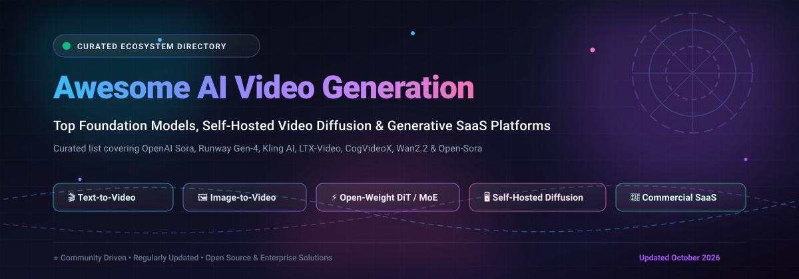

# Awesome AI Video Generation Models 🎬✨

  

  
  
  
  
  
  

---

## 🌟 Overview & Ecosystem

Welcome to the definitive, curated index of **AI Video Generation Models**, **Text-to-Video (T2V)**, **Image-to-Video (I2V)**, and **Video-to-Video (V2V)** diffusion technologies. 

Whether you are looking for production-ready **commercial SaaS platforms** with cinematic camera motions (Runway Gen-4, OpenAI Sora, Kling AI) or exploring bleeding-edge **open-source weights and self-hosted DiT diffusion models** (LTX-Video, Open-Sora, Wan2.2, CogVideoX, Mochi 1), this guide organizes the landscape by capabilities, pricing, star counts, and hardware efficiency.

> 💡 **Key Focus Areas**: Text-to-Video synthesis, Generative AI video tools, Video Diffusion Transformers (DiT), Mixture-of-Experts (MoE) video models, ComfyUI workflows, and local GPU self-hosting.

---

## 📑 Table of Contents

- [📊 Sector Overview & Market Dynamics](#-sector-overview--market-dynamics)
- [💼 SaaS & Hosted Platforms](#-saas--hosted-platforms)
- [💻 Open-Source Repositories & Weights](#-open-source-repositories--weights)
- [🤝 How to Contribute](#-how-to-contribute)
- [⚠️ Disclaimer & Licensing](#️-disclaimer--licensing)
- [📈 Star History](#-star-history)
- [☕ Support & Sponsorship](#-support--sponsorship)

---

## 📊 Sector Overview & Market Dynamics

The global AI video generation market is estimated between **$850M and $5.5B+ in 2026**, expanding rapidly toward **$20B–$70B+ by the early 2030s** at an estimated CAGR exceeding 25–35%. The sector exhibits **moderate fragmentation with rapid consolidation pressure**; while frontier foundation model providers and established software incumbents (OpenAI, Adobe, Kuaishou/Kling) command the largest enterprise pipelines and distribution moats, specialized prosumer startups (Runway, MiniMax, PixVerse, Luma, Pika) sustain significant market share through creative tooling workflows, agile community ecosystems, and rapid model iterations.

---

## 💼 SaaS & Hosted Platforms

The following hosted SaaS platforms provide state-of-the-art cinematic outputs via managed cloud APIs and web interfaces, ranked by company size and enterprise valuation:

| Product | Company Size / Valuation / Revenue | Starting Pricing | Free Tier Limit | Description |
| :--- | :--- | :--- | :--- | :--- |
| **[Sora (OpenAI)](https://openai.com/sora)** | Valuation: **~$850B+** (ARR: ~$13B–$50B run rate) | **$20/mo** (ChatGPT Plus tier) or API from **$0.30/s** (Sora 2 Pro) | **Free tier**: Limited trial access on select accounts with watermarks and strict duration/resolution caps. Full Sora access begins on Plus ($20/mo). | OpenAI's video generation model with native audio, high prompt fidelity, and up to 1080p/20s output. |
| **[Adobe Firefly Video](https://www.adobe.com/products/firefly/plans.html)** | Market Cap: **~$105B** (Full-year revenue: ~$23.8B) | **$9.99/mo** (Firefly Standard, 2,000 monthly credits) | **Free forever plan**: Daily generative credit allowance resetting every 24 hours (for test-generation of images/short video clips with platform caps). | Adobe's generative video model deeply integrated into Premiere Pro and the Firefly creative ecosystem. |
| **[Kling AI](https://klingai.com/)** | Valuation: **$18B** (Parent: Kuaishou ~$25B+ market cap) | **$6.99/mo** first month, then **$8.80/mo** (Standard tier, 660 credits) | **Basic plan (Free forever)**: 66 free daily credits (resets daily, non-commercial use only, standard queue, up to 720p watermarked). | Chinese AI video platform with Kling 3.0/4.0 models, multi-shot generation, and native cinematic camera controls. |
| **[Hailuo AI](https://hailuoai.video/)** | Market Cap: **~$8.2B–$11.4B** (MiniMax public on HKEX: 00100) | **$9.90/mo** (annual) or **$19.90/mo** (Standard tier, 1,600 credits) | **Free forever plan**: ~200 welcome credits + daily bonus credits (expires after 3 days; max 768p, 6s duration, watermarked, 1 concurrent job). | MiniMax's video platform featuring Hailuo 2.3 and MiniMax H3 models with high motion dynamics. |
| **[Runway](https://runwayml.com/)** | Valuation: **$5.3B** (Raised $315M Series E in 2026) | **$12/mo** (billed annually) or **$15/mo** (Standard tier, 625 credits/mo) | **Free plan**: 125 one-time credits (~25s of Gen-4/Gen-3 Turbo video, watermarked, non-refreshing). | Leading AI video creation platform featuring Gen-3 Alpha, Gen-4, and Aleph models with video-to-video editing. |
| **[PixVerse](https://pixverse.ai/)** | Valuation: **$2.0B+** (Raised $550M+ total, Series C extension) | **$8/mo** (billed annually) or **$10/mo** (Standard tier, 1,200 credits/mo) | **Basic plan (Free forever)**: 60 signup credits + 30 daily credits (resets daily, 540p resolution cap, watermarked, personal use). | AI video platform with V6 and C1 models, fast rendering pipelines, and camera motion presets. |
| **[Luma Dream Machine](https://lumalabs.ai/)** | Valuation: **~$500M** (Series B funded by a16z, NVIDIA) | **$25/mo** (annual) or **$30/mo** (Plus tier, 10,000 credits/mo) | **Free forever tier**: 30 free video generations/month (~1 generation/day allowance, standard priority queue, 720p, watermarked). | Cinematic AI video generation platform powered by Ray 2/Ray 3 models and Luma camera agents. |
| **[Pika](https://pika.art/)** | Valuation: **~$470M–$700M** (Series B led by Spark Capital) | **$8/mo** (billed annually) or **$10/mo** (Starter tier, 700 credits/mo) | **Free forever plan**: Access to models with 2 parallel generation queues, no monthly recurring credit top-up (pay-per-pack or initial trial credits, personal use only). | Creative video generation platform with Seedance, Wan, and Pika models, sound effects, and Pikaffects. |
| **[Kaiber](https://kaiber.ai/)** | Valuation: **~$10M–$20M** (Seed funded by EQT, ARR ~$2.6M) | **$8/mo** (annual) or **$10/mo** (Starter tier, 500 credits/mo) | **5-Day Free/Trial plan**: $5 promotional trial converts to Creator, or free account with limited initial test credits for canvas mode. | Stylized AI video generation studio focused on animators, music videos, beat synchronization, and visual artists. |

---

## 💻 Open-Source Repositories & Weights

Open-source and open-weight diffusion models allow developers and creators to host video generation on their own hardware, integrate into ComfyUI pipelines, and train custom LoRA weights. 

Repositories are sorted below in **descending order by GitHub star count**:

- ### 1. **[Open-Sora](https://github.com/hpcaitech/Open-Sora)**   
  **Democratizing efficient video production for everyone.** HPC-AI Tech's complete open-source initiative providing full hardware-efficient training and inference pipelines. Supports video latent diffusion models (STDiT architecture), dynamic resolutions, and full sequence conditioning.

- ### 2. **[Stable Video Diffusion (SVD)](https://github.com/Stability-AI/generative-models)**   
  **The foundational open image-to-video diffusion architecture.** Stability AI's flagship repository featuring SVD and SVD-XT (generating 14 to 25 frames at 576×1024). Serves as the community baseline for camera-motion LoRA fine-tuning and academic video research.

- ### 3. **[Wan2.2](https://github.com/Wan-Video/Wan2.2)**   
  **State-of-the-art Mixture-of-Experts (MoE) video generation.** Alibaba's open suite featuring Wan2.2-I2V-A14B and Wan2.2-TI2V-5B. Offers native 720p cinematic synthesis, exceptional motion realism, and optimized 24GB VRAM execution with consumer GPU offloading.

- ### 4. **[CogVideoX](https://github.com/zai-org/CogVideo)**   
  **High-resolution 3D VAE diffusion model.** Developed by Tsinghua University and Zhipu AI under **Apache 2.0**. Features 768×1360 resolution, up to 10-second outputs, expert 3D full-attention architecture, and deep understanding of long 226-token detailed prompts.

- ### 5. **[HunyuanVideo](https://github.com/Tencent/HunyuanVideo)**   
  **Tencent's frontier open-source foundation video model.** Features an 8.3B parameter Diffusion Transformer (DiT) integrating unified dual-stream text processing, 3D VAE video compression, and high-fidelity prompt compliance for photorealistic text-to-video.

- ### 6. **[AnimateDiff](https://github.com/guoyww/AnimateDiff)**   
  **Universal motion module for personalized text-to-image models.** Enables animation across community Stable Diffusion checkpoints (SD1.5, SDXL) without task-specific tuning. Widely utilized in ComfyUI and Automatic1111 workflows for stylised creator animation.

- ### 7. **[Open-Sora-Plan](https://github.com/PKU-YuanGroup/Open-Sora-Plan)**   
  **Peking University & Yuan Group's open reproduction effort.** A modular reproduction of Sora-like Video DiT architectures supporting 3D-VAE, joint image-video pre-training, and continuous frame interpolation workflows.

- ### 8. **[LTX-Video](https://github.com/Lightricks/LTX-Video)**   
  **Faster-than-realtime inference on consumer hardware.** Lightricks' **Apache 2.0** model family generating 5 seconds of video in ~2 seconds. Integrates Video-VAE with a 192x spatial-temporal compression ratio, supporting multi-keyframe synthesis and sub-second prompt iterations.

- ### 9. **[Mochi 1](https://github.com/genmoai/mochi)**   
  **Largest 10B parameter open video architecture.** Genmo's **Apache 2.0** Asymmetric Diffusion Transformer (AsymmDiT). Renowned for prompt fidelity, fluid motion physics, ComfyUI nodes, and native LoRA fine-tuning support.

- ### 10. **[Video-LLaMA](https://github.com/DAMO-NLP-SG/Video-LLaMA)**   
  **Multimodal video-grounded language and instruction model.** Connects video encoders with audio perception and LLMs, powering conversational video grounding, editing instructions, and scene-level comprehension.

- ### 11. **[SkyReels-V1](https://github.com/SkyworkAI/SkyReels-V1)**   
  **Cinematic narrative & long-form video diffusion system.** Skywork AI's generation framework designed for expressive character animation, storytelling, and infinite-length cinematic sequence synthesis.

- ### 12. **[InternVideo](https://github.com/OpenGVLab/InternVideo)**   
  **Foundation models for video understanding and generation.** OpenGVLab's unified multimodal model family integrating video masked autoencoding, cross-modal alignment, and controllable synthesis backbones.

- ### 13. **[Show-1](https://github.com/showlab/Show-1)**   
  **Pixel-and-latent hybrid video diffusion.** Show Lab's approach combining pixel-space diffusion for high-motion consistency with latent diffusion for computational efficiency.

---

## 🤝 How to Contribute

We welcome contributions from researchers, video artists, and software engineers! 🚀

1. 🍴 **Fork** this repository.
2. 🌿 **Create a branch** for your updates (`git checkout -b feature/new-video-model`).
3. 📝 **Add your entry** under the appropriate SaaS or Open-Source section following the existing table or list format.
4. 🔗 Ensure all official model weights, project pages, and paper links are verified.
5. 📤 **Submit a Pull Request** with a brief summary of the model and its capabilities!

---

## ⚠️ Disclaimer & Licensing

- 📌 This repository is a **community-curated index** and does not constitute financial or commercial endorsement.
- 💳 **SaaS Pricing Transparency**: Subscription plans, credit burn rates, and daily allowances are determined by individual providers and subject to ongoing adjustments.
- ⚙️ **Compute Requirements**: Running 10B+ open-weight models (e.g. Mochi 1, CogVideoX, Wan2.2-A14B) requires high-end VRAM (24GB–80GB); models such as LTX-Video and distilled checkpoints are recommended for consumer GPUs.
- ⚖️ **Commercial Licensing**: Verify each model's license (e.g., Apache 2.0 vs. non-commercial research licenses) prior to deploying in production applications.

---

## 📈 Star History

---

## ☕ Support & Sponsorship

If this repository helps you navigate the generative AI video landscape, build cool tools, or discover open-source models, please consider supporting the project:

- ⭐ **Star this repository** to help others discover it!
- 🍴 **Fork and share** with fellow developers and creators.
- ☕ **Buy me a coffee / Sponsor the project**: [**Sponsor on GitHub**](https://github.com/sponsors/ishandutta2007)

Thank you to all community contributors, researchers, and sponsors for keeping open generative media accessible to all! 💖
